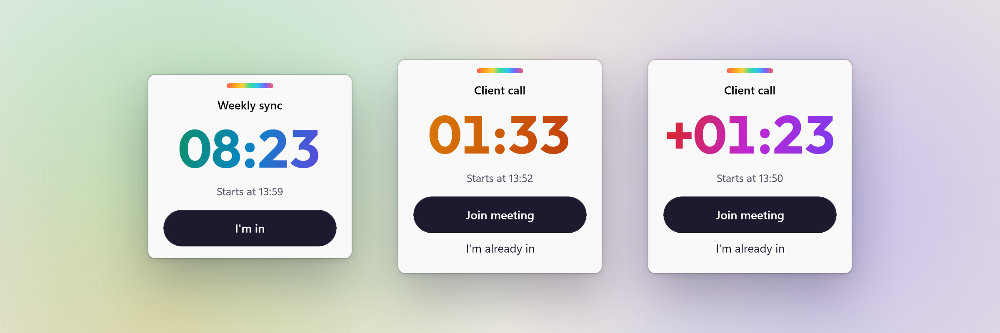
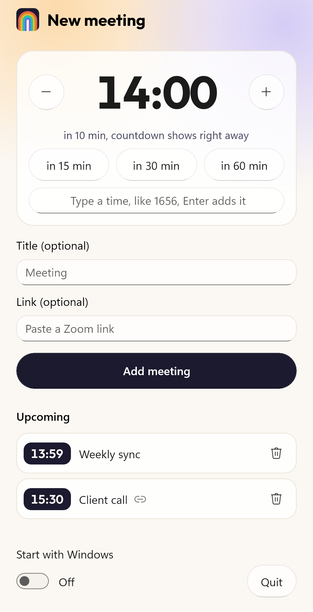

<p align="center">
  
</p>

<h1 align="center">Tunnel Timer</h1>

<p align="center"><strong>Stay in the tunnel. Still make the call.</strong></p>

<p align="center">
  A small countdown for Windows 11 that floats above your work before a meeting.<br>
  You can move it anywhere. You cannot dismiss it, until you are in.
</p>

<p align="center">
  <a href="https://apps.microsoft.com/detail/9P3TCQN74F6F"></a>
  
  
  
  <a href="LICENSE"></a>
</p>

<p align="center">
  
</p>

## Why

You sit down thirty minutes before a call, start working, and look up at five past. An alarm does not help: you switch it off and are back in the problem a minute later. The clock in the taskbar is too small to notice.

Tunnel Timer puts the time where you cannot miss it and leaves you alone otherwise. No sound, no blinking, no stolen focus. Just a countdown that stays on top of everything until you say you are in the meeting.

## How it works

1. Click the rainbow icon in the notification area.
2. Type the start time as digits and press Enter: `1656` is 16:56, `930` is 9:30. Or pick "in 15 min", "in 30 min" or "in 60 min", or set the time with plus and minus. Title and meeting link are optional. The panel closes once the meeting is added.
3. Keep working. Ten minutes before the start the countdown appears above all windows.
4. Drag it wherever it is not in the way. It remembers the spot.
5. Press **Join meeting** to open your link, or **I'm in** if you joined on your own. Only then does it go away.

<p align="center">
  
</p>

The colour tells you how close you are:

| Phase | When | Look |
| --- | --- | --- |
| Upcoming | 10 to 2 minutes before | Cool colours, calm |
| Imminent | Last 2 minutes | Warm colours |
| Overdue | After the start | Counts up with a plus sign, because sometimes you join a minute late on purpose |

## Good to know

- **It cannot be closed.** That is the point. No close button, not in Alt+Tab, Alt+F4 does nothing. The meeting has to be acknowledged.
- **It never takes focus.** The widget appears without interrupting what you are typing.
- **Meeting links** open in your default browser. A Zoom link is handed to the Zoom app from there. Only `https` and `http` addresses are accepted.
- **Several meetings** can be planned. The widget shows the earliest one and moves on to the next when you are in.
- **It survives restarts.** Open meetings and the widget position are stored locally. If the app ever crashes, Windows starts it again.
- **Start with Windows** is a switch in the panel and off by default.
- **English and German**, following your Windows display language.

## Privacy

Tunnel Timer has no account, no telemetry and makes no network requests. Your meetings are stored in a file on your PC and nowhere else. The only thing that ever leaves the app is the meeting link you ask it to open. Details are in the [privacy policy](PRIVACY.md).

## Install

Tunnel Timer is free. It has been submitted to the Microsoft Store as [Tunnel Timer: Meeting Countdown](https://apps.microsoft.com/detail/9P3TCQN74F6F) and is in certification; the link works once Microsoft has published it. Until then, build it yourself:

```powershell
git clone https://github.com/shroomlife/tunnel-timer.git
cd tunnel-timer
dotnet build src/TunnelTimer.App/TunnelTimer.App.csproj -c Release -p:Platform=x64 -p:AppxPackageSigningEnabled=false
```

Requirements: Windows 11, the [.NET 10 SDK](https://dotnet.microsoft.com/download) and the Windows SDK that ships with Visual Studio's "WinUI application development" workload. An unsigned package can be registered on a PC with Developer Mode enabled:

```powershell
dotnet build src/TunnelTimer.App/TunnelTimer.App.csproj -p:Platform=x64 -p:AppxPackageSigningEnabled=false
Add-AppxPackage -Register src\TunnelTimer.App\bin\x64\Debug\net10.0-windows10.0.26100.0\win-x64\AppxManifest.xml
```

## Development

```powershell
dotnet test --project tests/TunnelTimer.Core.Tests
```

| Part | What it does |
| --- | --- |
| `src/TunnelTimer.Core` | All time logic: phases, formatting, the schedule. No UI, fully unit tested. |
| `src/TunnelTimer.App` | WinUI 3 app: the widget, the panel, the notification area icon, storage. |
| `tests/TunnelTimer.Core.Tests` | xunit.v3 tests for the core. |
| `scripts/generate-icons.ps1` | Draws every icon size from one routine. |

Built with WinUI 3 on the Windows App SDK, .NET 10 and C#, packaged as MSIX. The countdown is never counted down: it is recomputed from the clock several times a second, so it stays correct after standby.

## Known issue

A visible WinUI 3 window can be terminated from outside by a UI Automation client ([microsoft-ui-xaml#11139](https://github.com/microsoft/microsoft-ui-xaml/issues/11139)). There is no fix an app can apply. Tunnel Timer registers for an automatic restart, so the countdown is back within seconds, unless the app had been running for less than a minute.

## License

Tunnel Timer is released under the [MIT License](LICENSE). You may use, change and share it, including commercially, as long as the copyright notice stays with it.

The bundled font [Outfit](https://github.com/Outfitio/Outfit-Fonts) is not covered by the MIT License. It is licensed under the SIL Open Font License 1.1, see [`Outfit-OFL.txt`](src/TunnelTimer.App/Assets/Fonts/Outfit-OFL.txt).

Made by [shroomlife](https://github.com/shroomlife).
